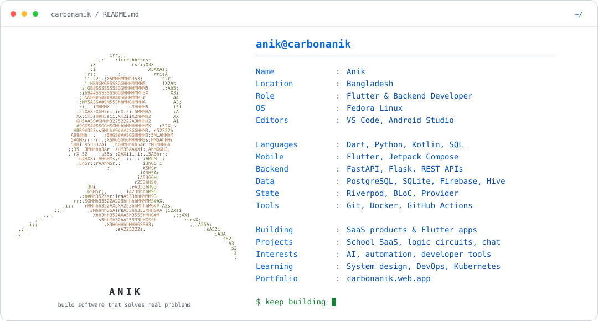
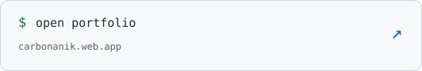
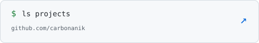

<a href="https://carbonanik.web.app">
  <picture>
    <source media="(prefers-color-scheme: dark)" srcset="assets/profile-dark.svg">
    
  </picture>
</a>

  <a href="https://carbonanik.web.app"><picture><source media="(prefers-color-scheme: dark)" srcset="assets/portfolio-dark.svg"></picture></a>
  <a href="https://github.com/carbonanik?tab=repositories"><picture><source media="(prefers-color-scheme: dark)" srcset="assets/projects-dark.svg"></picture></a>

<picture>
  <source media="(prefers-color-scheme: dark)" srcset="https://raw.githubusercontent.com/carbonanik/carbonanik/output/pacman-contribution-graph-dark.svg">
  
</picture>

<!-- Profile artwork: python3 tools/render_profile.py (requires Pillow).
     Contribution graphs are generated by .github/workflows/contributions.yml
     after the first push to main, then refreshed daily on the output branch. -->
